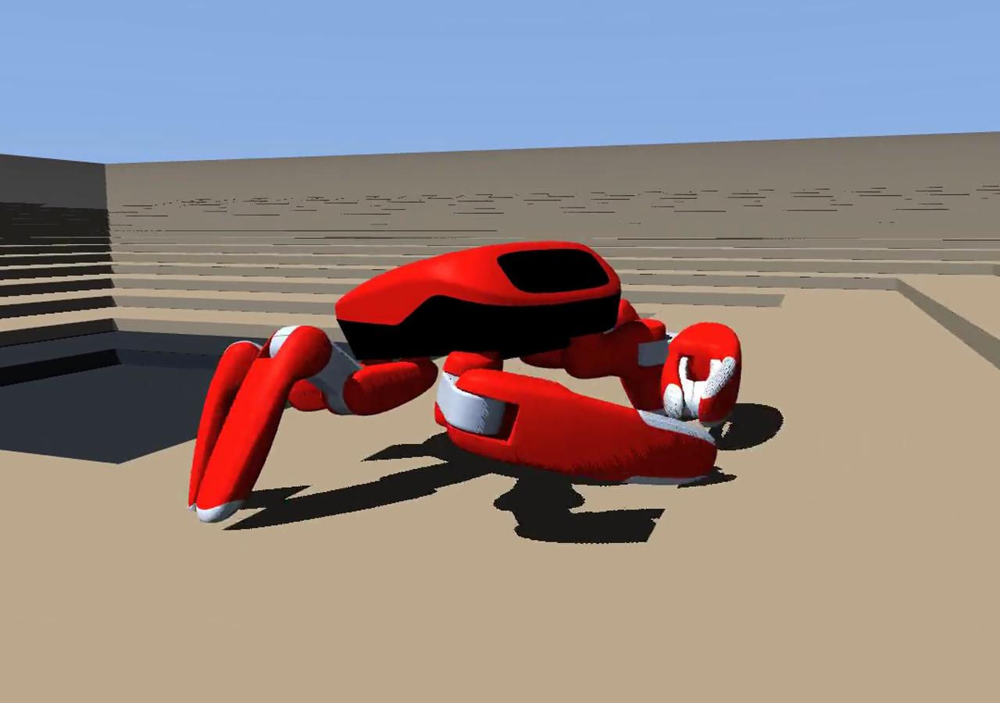
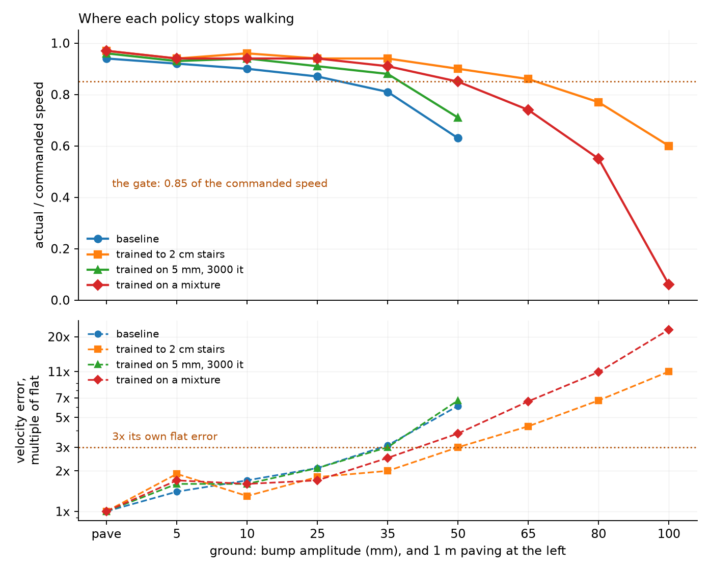
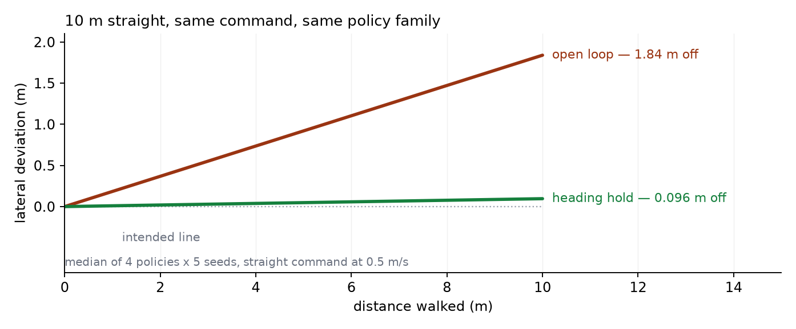
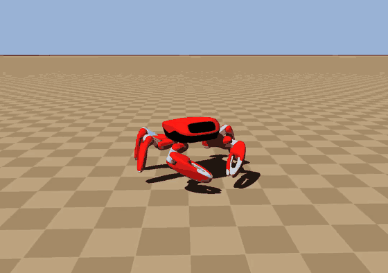
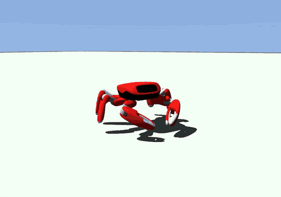
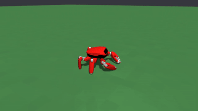
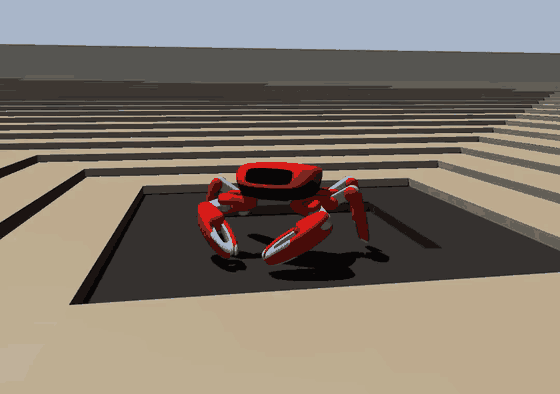
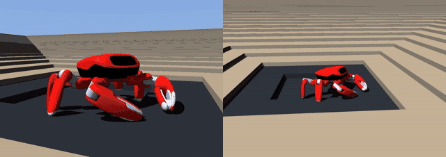
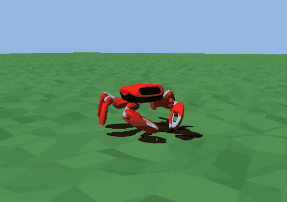
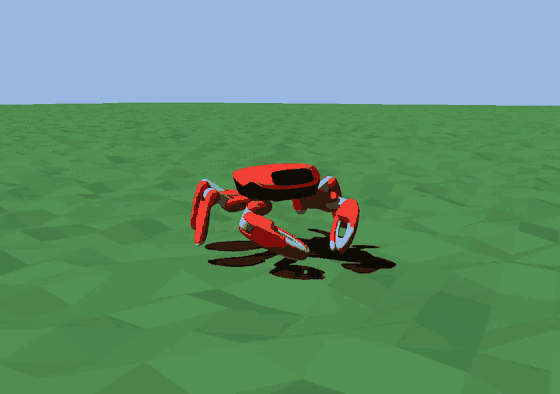

# Jumper locomotion — heading, terrain, and where the ceiling actually is



**English** | [简体中文](README.zh.md)

Work on the locomotion stack of **Jumper**, a 22-DoF crab robot, built on
[KingKongRobotics/jumper](https://github.com/KingKongRobotics/jumper) and the
[mjlab](https://github.com/mujocolab/mjlab) training framework it vendors. The robot, the
hardware and the upstream SDK are theirs; what is here is the training and control work
on top, plus the reports that record what the numbers are and what they are not.

**Read this first:** [docs/OVERVIEW.md](docs/OVERVIEW.md) — one page, the whole thread,
including the four directions that were tried and refused.

**The one-sentence claim:** on this platform, the terrain ceiling went from *never measured*
to *25 mm of bumps for the baseline policy, 50 mm for the policy trained up the staircase*,
the 3 cm staircase became walkable at 0.42 m/s, and straight-line heading error over 10 m
fell from ~1.8 m of lateral drift to **0.096 m**.

---

## The picture before the videos

Two figures, both drawn from tables that already existed — no new measurement, nothing
smoothed. The script that draws them is [`docs/figures/draw.py`](docs/figures/draw.py).



*Above: how much of the commanded speed each policy actually achieves, as the ground gets
rougher. Below, on a log scale: its velocity error as a multiple of its own flat-ground
error. The ceiling is where a curve crosses **both** lines — 25 mm for the baseline, 35 mm
for the rough-trained and mixture arms, 50 mm for the staircase one. Past 65 mm the mixture
policy collapses to 6 % of the commanded speed, which is the cliff made visible.*



*The heading story in one picture: after 10 m at 0.5 m/s the open-loop policy is 1.84 m off
its line; the same policy with the controller's heading loop is 0.096 m off. Drawn to scale
from the medians — the spread across seeds is ±3.9 m on the left and ±0.1 m on the right.*

---

## Two videos that carry the rest

**Straight walking, with and without the heading loop.** Same policy, same 50 mm bumps,
open loop on the left, the real controller on the right (the packaged `.app`, driven through
a scripted pad — not a Python-side correction).

[](docs/media/terrain-heading-hold.gif)

**One policy, three grounds.** A checkpoint trained on a 1:4 staircase-and-bumps mixture,
walking paving, 5 mm bumps and a 3 cm staircase.

| paving | 5 mm bumps | 3 cm stairs |
|:-:|:-:|:-:|
|  |  |  |
| 0.48 m/s, error 0.017 | 0.48 m/s, error 0.026 | 0.42 m/s, error 0.083 |

**The one that took the most work to get right, and the price of it.** Left: a policy that
walked 2 cm stairs and was then trained on 3 cm — it climbs. Right: a policy trained on
3 cm from flat ground — it stands at the bottom, because 3 cm is past the training boundary
even though the policy above walks 4 cm fine.

[](docs/media/terrain-stairs3cm-compare.gif)

**Same 50 mm ground, two policies.** Left: the baseline, which stalls. Right: the policy
trained on 5 mm bumps, which keeps walking.

| baseline | trained on 5 mm |
|:-:|:-:|
|  |  |

---

## Numbers, each with its condition

| Result | Number | Condition |
|:--|:--|:--|
| Terrain ceiling, baseline policy | **25 mm** | 6000-step runs, speed ratio ≥ 0.85 and error ≤ 2× its own flat error |
| Terrain ceiling, staircase-trained policy | **50 mm** | same rule; the cliff sits between 50 and 65 mm |
| 3 cm staircase | **0.252 → 0.418 m/s**, error 0.2481 → 0.0828 (**−66 %**) | 14 seeds, paired, p = 0.0078 |
| Straight-line heading after 10 m | **1.8 m → 0.096 m**, 0.7° | `kp = 2.0`, 4 policies × 2 grounds × 5 seeds |
| 1:4 staircase/bump mixture | **−66 % / −43 % / −53 %** | stairs / 5 mm / paving, 14 seeds, all pass the gate |
| 4 cm staircase | **rejected** | the arm walks 0.061 m/s on its own rung and drags 3 cm from 0.415 → 0.220 m/s |
| Critic-only terrain scan | **null result** | entropy 6.97 vs 7.23, error 0.1786 vs 0.1796 against a no-scan control |
| Foot odometry | **0.19–0.20 m per 10 m** | body frame, median of 5 estimators over 12 walks |

The rule behind every row: **a number without its conditions does not exist** — replay is
not reproducible across processes, so comparisons are paired inside one run, and a
difference below the measurement's resolution is not a difference
([`docs/EXPLORATION.md`](docs/EXPLORATION.md)).

---

## What I built

| Area | Work |
|:--|:--|
| Terrain | Seeded generator (a fixed surface per seed), climbing stairs that rise outward instead of descending, a staircase-plus-bumps mixture with a configurable share, and refusals for combinations that cannot be replayed |
| Training | A stall termination that ends an episode when the command asks for travel and the body does not move — installed for training only, so replays keep their old meaning; a rung probe that refuses only grounds a policy cannot walk |
| Control (Rust, `deploy/fsm`) | Heading hold validated against the exported contract: the correction is added to the commanded yaw rate, the sum is clamped to the trained axis, and a malformed block or a deploy hook is refused at construction |
| Estimation | Forward kinematics for all six legs from the model (checked against MuJoCo to 2e-4 m), foot odometry in the body frame, and a pure-pursuit line loop on top of it |
| Measurement | Cross-track distance in the replay evaluation, scripted pad input so the packaged controller can be driven headlessly, and a stall counter that does not truncate episodes |
| Protocol | The rules in `docs/EXPLORATION.md`: pair inside a run, compute the resolution before judging, report the failure point as the result |

## What the results say, including the parts that did not work

- **The ceiling is speed collapse, not falling.** Across 107 scan cells the episode-reset
  count was zero everywhere; a resets-based gate can never fire here.
- **"Can walk" and "can be trained" are different curves**, and the second is earlier:
  at 3.5 cm the policy still walks, but training there destroys the 3 cm gait.
- **A mixture keeps a capability; it does not create one.** From scratch, 6000 iterations
  on the mixture still trails a policy that learned the stairs first.
- **The line loop lost, and that is a result too**: foot odometry drifts 0.2 m in 10 m, and
  a loop correcting against it amplifies that to 0.9 m — the heading loop, which uses the
  IMU's absolute heading, reaches 0.04 m. The code is kept, the contract does not enable it.
- **A critic with a terrain scan changed nothing** measurable against a control trained
  identically with scan. Recorded as a null result rather than a quietly dropped branch.

---

## Reproduce

This repository is the **work itself, not a self-contained install**: it is a snapshot of the
changes made inside a checkout of [KingKongRobotics/jumper](https://github.com/KingKongRobotics/jumper),
whose vendored `mjlab` copy, robot meshes and vendored Rust crates stay upstream. Applied to
that checkout, the full tree runs 1719 Python tests and 255 controller tests.

```bash
# in the upstream checkout with this tree applied
.venv/bin/python -m pytest -q                  # 1719 tests
cd deploy/fsm && cargo test                    # 255 tests

# replay one policy on a fixed surface
.venv/bin/python scripts/play.py --checkpoint <run>/model.pt \
  --headless --steps 1000 --command 0.5 0 0 \
  --terrain --terrain-roughness-mm 5 --terrain-seed 0 \
  --evaluation-out out.json

# drive the packaged controller the way the demos do
.venv/bin/python scripts/play.py --app out/<name>/bundle.app \
  --app-pad Ly=-1.0 --headless --steps 400 --evaluation-out out.json
```

Trained checkpoints are not shipped here; the reports name the run directory each number
came from.

## Reports

Start with the one-page narrative: **[docs/OVERVIEW.md](docs/OVERVIEW.md)**. The nine notebooks
behind it are indexed bilingually in **[docs/reports/INDEX.md](docs/reports/INDEX.md)** (written in
Chinese; the index carries an English line for each).

| Report | What it answers |
|:--|:--|
| [Terrain scan and ceiling](docs/reports/research-terrain-scan-ceiling-20261031.md) | Where the baseline stops walking, and the three tool defects that made earlier scans meaningless |
| [Gate, L0–L1](docs/reports/research-l0-gate-terrain-paved-20261031.md) | The gate itself: why yaw MAE was the wrong quantity, and what replaced it |
| [Terrain ladder](docs/reports/research-terrain-ladder-20261101.md) | Twelve training arms, the walkable-versus-trainable boundary, the staircase corners |
| [3 cm mixture](docs/reports/research-night-3cm-mix-20261103.md) | The mixture proportion, the 5 mm cost, and the measurement resolution ledger |
| [From-scratch mixture](docs/reports/research-mix14-from-scratch-20261104.md) | Whether a mixture can replace "walk there first" — it cannot |
| [Heading drift](docs/reports/research-heading-drift-20261102.md) | How far a policy drifts over 10 m, measured directly, and why integrating the mean yaw rate lies |
| [Heading loop](docs/reports/research-heading-loop-20261102.md) | The loop's effect in simulation and the knee in its gain |
| [Heading hold in the controller](docs/reports/research-heading-hold-controller-20261102.md) | The same loop in Rust, its contract, and what it refuses |
| [Pursuit and the line loop](docs/reports/research-pursuit-line-20261104.md) | Foot odometry, forward kinematics, and the loop that lost to the IMU |

## Credit

- **Jumper** — hardware, SDK and the original repository: KingKong Robotics, Apache-2.0.
- **[mjlab](https://github.com/mujocolab/mjlab)** — the training framework this stack vendors (1.6.0, Apache-2.0), with five files marked `[mjrl]` where they were changed; the list is in `docs/VENDOR.md`.
- **Isaac Lab** — parts of `lab_api` derive from it (BSD-3-Clause).
- **MuJoCo Menagerie** — robot assets (BSD-3-Clause).

`NOTICE` carries the full attribution; `licenses/` carries the third-party texts.

## Layout

```
tasks/jumper/     task definitions: observations, rewards, terrain, terminations
deploy/fsm/src/   the Rust controller: heading hold, forward kinematics, foot odometry, pursuit
scripts/          play, export, deploy
tools/            long runs, the run queue, health, the rung probe
tests/            Python tests; `cargo test` covers the controller
docs/reports/     the reports above
docs/EXPLORATION.md  the measurement rules this work follows
```