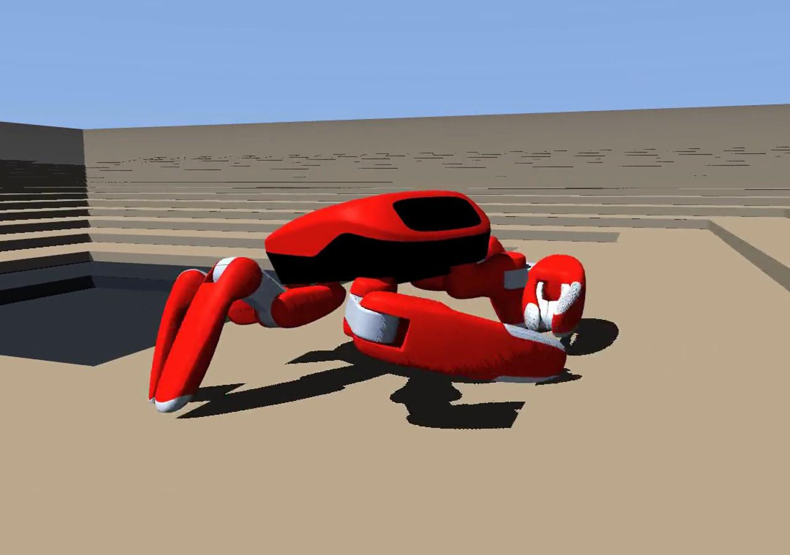
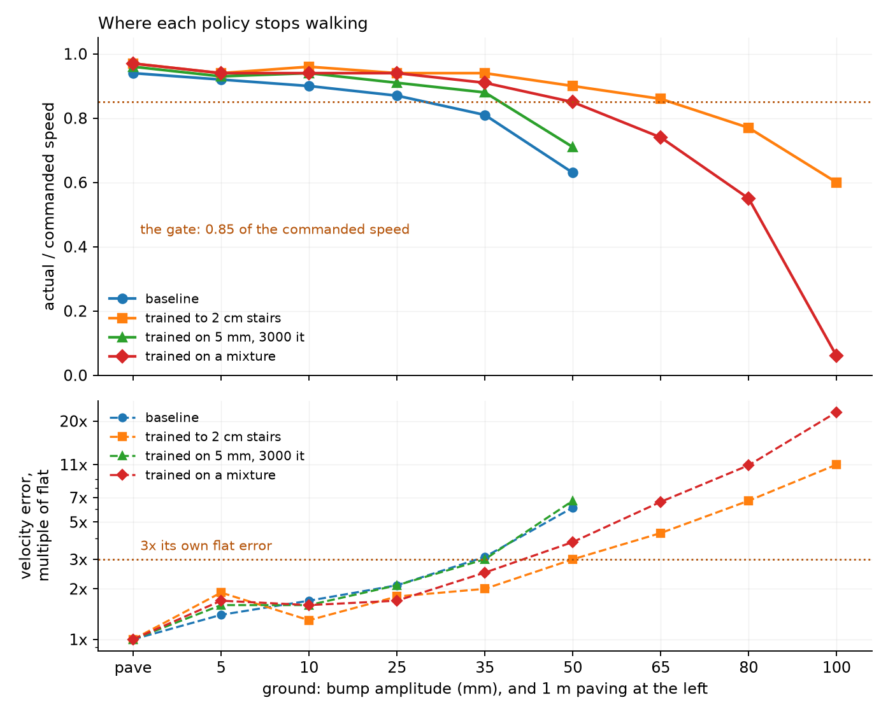
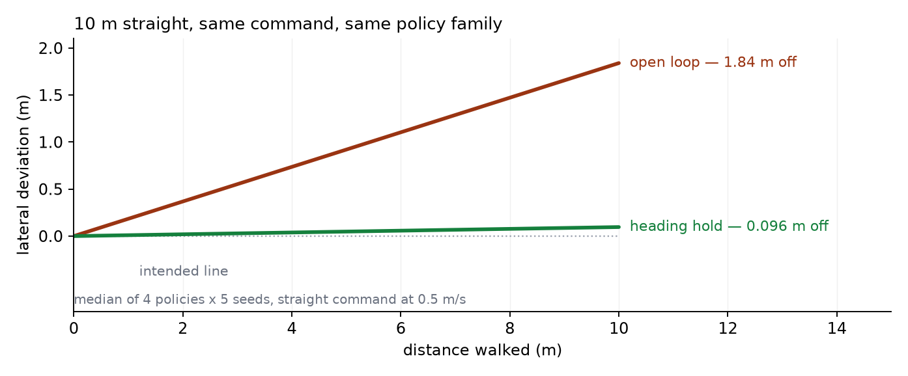
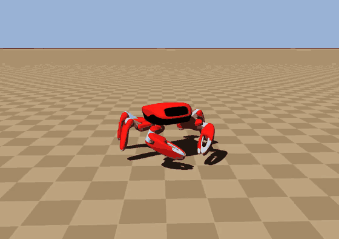
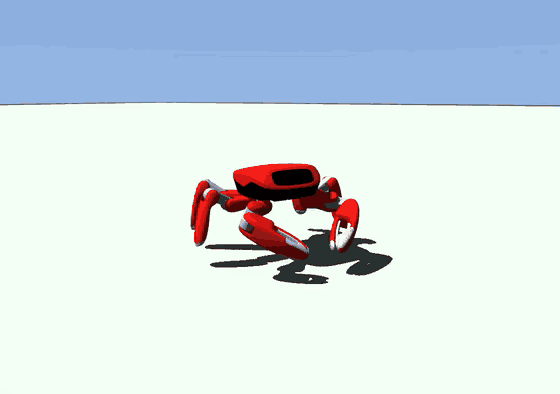
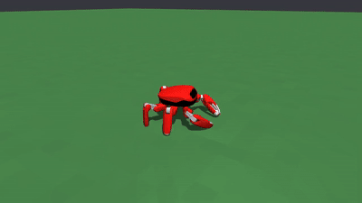
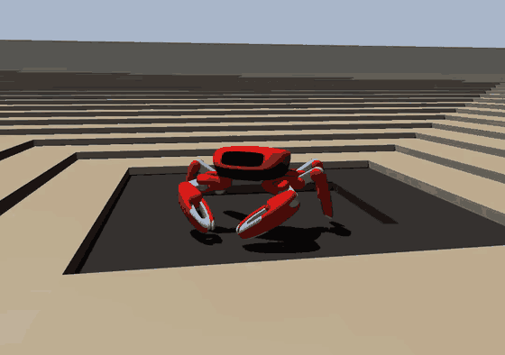
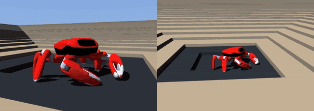
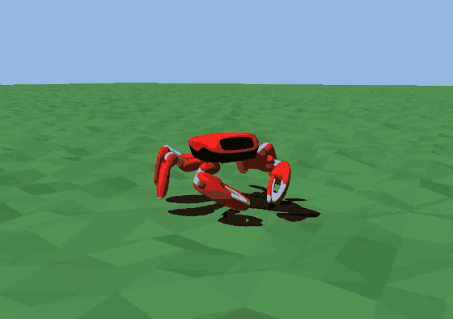
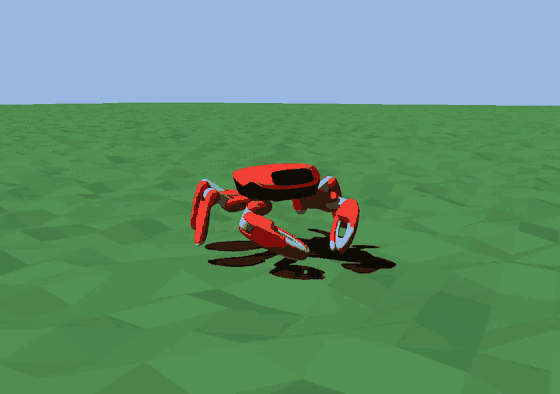

# Jumper 运动控制 — 航向、地形，以及天花板到底在哪



[](https://github.com/MorningStar0709/jumper-locomotion/actions/workflows/checks.yml)

[English](README.md) | **简体中文**

这是 22 自由度螃蟹机器人 **Jumper** 运动栈上的工作，建立在
[KingKongRobotics/jumper](https://github.com/KingKongRobotics/jumper) 与它 vendor 的
[mjlab](https://github.com/mujocolab/mjlab) 之上。机器人、硬件与上游 SDK 是他们的；
这里是其上的训练与控制工作，以及记录"这些数字是什么、不是什么"的报告。

**先读这一页：** [docs/OVERVIEW.md](docs/OVERVIEW.md)（英文，一页讲完整条线索，含四个被否决的方向）。

**一句话：** 在这套平台上，地形天花板从*没测过*变成*基线策略 25 mm、沿台阶练上去的策略 50 mm*，
3 cm 台阶可以 0.42 m/s 走上去，直走 10 米的横向偏差从约 1.8 m 降到 **0.096 m**。

## 先看图，再看动图

两张图都直接取自已有的表，没有新测量、没有平滑；画图脚本是 [`docs/figures/draw.py`](docs/figures/draw.py)。



*上：地面越粗，每条策略实际跑出指令速度的几成。下（对数轴）：它的速度误差是自己平地的几倍。
天花板是曲线**同时**越过两条线的位置——基线 25 mm、起伏与混合两条臂 35 mm、台阶那条 50 mm。
过了 65 mm，混合策略只剩 6% 的指令速度，断崖一眼可见。*



*航向这条线一张图：走完 10 米、0.5 m/s，开环偏 1.84 m，加了控制器里的航向环是 0.096 m。
按中位数等比绘制——左侧种子跨度 ±3.9 m，右侧 ±0.1 m。*

## 两张最有说服力的动图

同一策略、同一台 50 mm 起伏：左侧开环，右侧是**真的控制器**（打包好的 `.app`，脚本摇杆驱动，不是在 Python 侧补的修正）。

[](docs/media/terrain-heading-hold.gif)

一个在 1:4 台阶与起伏混合地面上练出来的 checkpoint，分别走铺装、5 mm 起伏与 3 cm 台阶：

| 铺装 | 5 mm 起伏 | 3 cm 台阶 |
|:-:|:-:|:-:|
|  |  |  |
| 0.48 m/s，误差 0.017 | 0.48 m/s，误差 0.026 | 0.42 m/s，误差 0.083 |

**最费劲的一条，以及它的代价。** 左：先走通 2 cm、再续训 3 cm 的策略，能上去。
右：从平地直接训 3 cm 的策略，站在下面不动——3 cm 已越过训练边界，尽管左边那条走 4 cm 都没问题。

[](docs/media/terrain-stairs3cm-compare.gif)

**同一片 50 mm 地面，两条策略。** 左：基线，原地停住。右：在 5 mm 起伏上练过的策略，继续走。

| 基线 | 5 mm 训过 |
|:-:|:-:|
|  |  |

## 数字与条件

| 结论 | 数字 | 条件 |
|:--|:--|:--|
| 基线策略的地形天花板 | **25 mm** | 6000 步长窗，速度比 ≥ 0.85 且误差 ≤ 自身平地的 2 倍 |
| 沿台阶练上去的策略 | **50 mm** | 同一条规则；悬崖在 50 与 65 mm 之间 |
| 3 cm 台阶 | **0.252 → 0.418 m/s**，误差 0.2481 → 0.0828（**−66 %**） | 14 种子配对，p = 0.0078 |
| 直走 10 米横向偏差 | **1.8 m → 0.096 m**，航向 0.7° | `kp = 2.0`，4 策略 × 2 地面 × 5 种子 |
| 1:4 混合地面 | **−66 % / −43 % / −53 %** | 台阶 / 5 mm / 铺装，14 种子，全部过闸 |
| 4 cm 台阶 | **否决** | 该臂在自己那一档只能走 0.061 m/s，并把 3 cm 从 0.415 拖到 0.220 |
| critic 只看地形 | **空结果** | 熵 6.97 vs 7.23、误差 0.1786 vs 0.1796，对照为同配置无扫描 |
| 足端里程计 | **10 米 0.19–0.20 m** | 机体系，五种估计器、12 次行走的中位 |

这些行的规则同一条：**没有条件的数字不算数字**——回放跨进程不可复现，所以比较都在同一次行走里配对，
低于分辨力的差异不算差异（[`docs/EXPLORATION.md`](docs/EXPLORATION.md)）。

## 我做了什么

- **地形**：可复现的表面（种子定地表）、向外**爬升**的台阶（不是向下）、台阶与起伏的混合地面与可调配比，以及不能回放的组合直接拒绝。
- **训练**：命令要求在走而身体没走出去时终止回合的"停滞"条件——只在训练里装，回放保持原语义；以及只拒绝"走都走不动"地面的档位探针。
- **控制（Rust）**：受导出契约校验的航向保持——修正**加**在指令角速度上，和夹在训练过的轴内，坏块或部署钩子在建契约时就拒绝。
- **估计**：六条腿的正解算（与 MuJoCo 校到 2e-4 m）、机体系足端里程计、其上的纯追踪直线回路。
- **测量**：评测里的横向偏差、让打包控制器能无头驱动的脚本摇杆、不截断回合的停滞计数。
- **协议**：`docs/EXPLORATION.md` 里的那几条规矩。

## 结果里包括没走通的部分

- **天花板是速度塌陷，不是摔倒**：107 格里回合重置数全为 0，按重置数设的闸永远不会触发。
- **"能走"与"能训"是两条曲线**，后者更早：3.5 cm 还走得了，但在那儿训练会毁掉 3 cm 的步态。
- **混合能保住能力，不能创造能力**：从零练 6000 iter 仍落后于"先走过去再续训"。
- **直线回路输了，这也是结果**：足端里程计 10 米漂 0.2 m，回路按它纠偏会放大到 0.9 m；只用 IMU 绝对航向的航向环是 0.04 m。代码保留，契约不启用。
- **critic 带地形扫描没有可测差异**，如实记为 null，而不是悄悄丢掉这个分支。

## 接下来我会做什么

三个开口，按我会采取的次序——每一条都是上面工作留下的、仍可测量的问题，不是愿望：

1. **3 cm 以上的台阶。** 两次往上迈（3.5 cm 与 4 cm，都从 3 cm 那臂续训）都把步态毁掉了，而同一条策略
   自己走 4 cm 毫无问题。这说明缺的是课程而不是天花板：把 3 cm 与 4 cm 的瓦片混在一片地面上，可以让策略
   遇到更陡的台阶，而不至于让整片地面离开它训过的分布。混合机制已经有了，缺的是一档按**深度**而不是按
   幅度变化的训练面。
2. **一个够用的位姿来源。** 直线回路输给纯 IMU 回路一个数量级，原因是航位推算：10 米漂 0.19 米，再被
   纠偏的回路放大。足端里程计不是调参能救的——滑移从脚上不可观测。诚实的选择只有两个：引入第二参考
   （机器人没有相机），或者只在短时窗内用它、不让漂移累积。
3. **真机上的第一小时。** 这里的结论没有一条碰过板子。两个常量与控制频率绑定，会是首先要复核的：停滞判定
   窗口（50 Hz 下 75 拍）与航向增益（2.0 rad/s per rad），两者都假设环在真机上仍跑在 50 Hz。

## 复现

本仓是**工作本身，不是可独立安装的包**：它是叠加在
[KingKongRobotics/jumper](https://github.com/KingKongRobotics/jumper) 检出上的改动快照，
vendor 的 `mjlab`、机器人网格与 Rust vendored crates 留在上游。叠加后全树 1719 项 Python 测试、
255 项控制器测试通过。训练权重不进仓库，每个数字对应的 run 目录在报告里。

## 致谢

上游是 **Jumper**（KingKong Robotics，Apache-2.0）；训练框架 [mjlab](https://github.com/mujocolab/mjlab) 1.6.0（Apache-2.0，五处修改以 `[mjrl]` 标注，清单见 `docs/VENDOR.md`）；
`lab_api` 部分派生自 **Isaac Lab**（BSD-3-Clause）；机器人资产来自 **MuJoCo Menagerie**（BSD-3-Clause）。
完整声明见 `NOTICE`，第三方许可证全文在 `licenses/`。

## 报告

先读能独立读的一页：**[docs/OVERVIEW.md](docs/OVERVIEW.md)**。它背后的九篇笔记本由 **[docs/reports/INDEX.md](docs/reports/INDEX.md)** 索引（正文为中文，每篇附一句英文）。

| 报告 | 回答什么 |
|:--|:--|
| [地形扫描与天花板](docs/reports/research-terrain-scan-ceiling-20261031.md) | 基线在哪里走不动，以及让早期扫描失去意义的三个工具缺陷 |
| [闸门 L0–L1](docs/reports/research-l0-gate-terrain-paved-20261031.md) | 闸门本身：为什么偏航 MAE 是错的量，以及替代它的三条规则 |
| [地形阶梯](docs/reports/research-terrain-ladder-20261101.md) | 十二个训练臂、"能走"与"能训"两条曲线、台阶的三处拐角 |
| [3 cm 混合](docs/reports/research-night-3cm-mix-20261103.md) | 混合配比、5 mm 的代价，以及分辨力台账 |
| [从零混合](docs/reports/research-mix14-from-scratch-20261104.md) | 混合能否替代"先走过去"——不能 |
| [航向漂移](docs/reports/research-heading-drift-20261102.md) | 直走 10 米偏多少，以及积分平均偏航率为何会骗人 |
| [航向环](docs/reports/research-heading-loop-20261102.md) | 回路在仿真里的效果与增益拐点 |
| [控制器里的航向保持](docs/reports/research-heading-hold-controller-20261102.md) | 同一回路的 Rust 实现、契约与拒绝项 |
| [纯追踪与直线回路](docs/reports/research-pursuit-line-20261104.md) | 足端里程计、正解算，以及输给 IMU 的回路 |

## 目录结构

```
tasks/jumper/    任务定义：观测、奖励、地形、终止条件
deploy/fsm/src/  Rust 控制器：航向保持、正解算、足端里程计、纯追踪
scripts/         play、export、deploy
tools/           长跑、队列、健康判诊、档位探针
tests/           Python 测试；`cargo test` 覆盖控制器
docs/reports/    上面十篇报告
docs/EXPLORATION.md  本工作遵循的测量规矩
```
