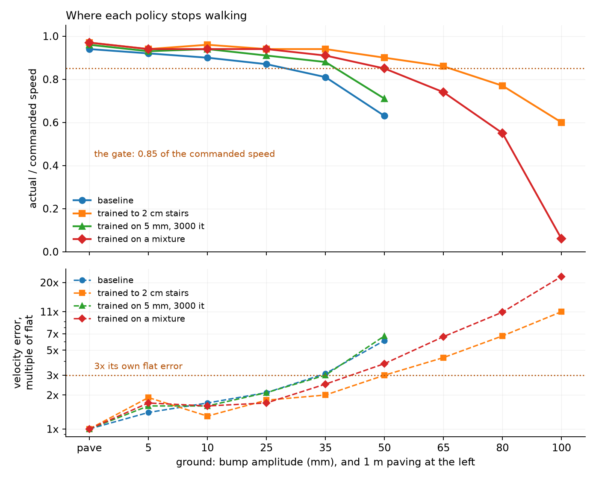
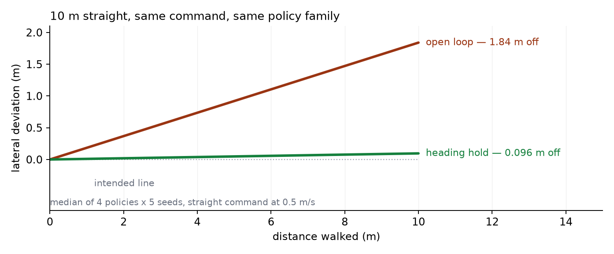

# What this work is, in one page

Six legs, 22 degrees of freedom, no camera. The policy sees 411 numbers — joint angles and
velocities, the last actions, foot heights, foot contacts, a short history — and emits 20 target
joint positions at 50 Hz. It never sees the ground ahead of it. Everything below follows from
that one constraint: if the robot cannot perceive the terrain, then whatever terrain it survives
has to be paid for in training, and whatever it cannot survive has to be found by measurement
rather than argument.

This repository is the result: the tasks, the training runs, the controller changes, and the
reports behind every number — including the four directions that were tried and refused.

## The measurement had to be built first

The first scan of the existing policy produced a result that looked like success and was
meaningless: 107 replay cells, **zero falls in every one of them**. A gate written as "the
episode reset" can never fire, so it says nothing. What actually degrades is speed: on 1 m paving
the straight-line velocity error is 0.033 m/s; at 25 mm of roughness it is 0.066; at 50 mm it is
0.175 and the robot is walking at 63 % of the speed it was asked for; at 80 mm it is 0.462 — the
robot stands up and stalls in place.

Two more defects made earlier numbers untrustworthy, and both were in the tools rather than the
policy: the terrain generator drew an unseeded surface, so every run trained and every replay
measured a different ground, and the simulation's contact budget (160) silently stopped covering
the ground past 20 mm. Both were fixed before anything was concluded — the surface is now
deterministic from `--terrain-seed`, and the budget is measured rather than guessed
([scan report](reports/research-terrain-scan-ceiling-20261031.md)).

Then the measurement itself was calibrated. One checkpoint on one fixed surface, replayed with
eight seeds, varies by 52 % on velocity error and 41 % on heading error. A "no worse than 5 %"
criterion is therefore not a criterion — it is noise with a threshold drawn on it. The gate that
replaced it asks three questions instead: does the policy still walk (speed), does it still go
where it was told (net heading bias rather than heading noise), and does the loss of speed exceed
15 % with a permutation test that says it is unlikely to be chance. That last part matters more
than it sounds: at seven seeds the test can only resolve effects two to three times larger than
the ones we were arguing about, and saying so is part of the result
([gate report](reports/research-l0-gate-terrain-paved-20261031.md)).

## Where the terrain ceiling is

With the gate in place, four policies were walked over ten ground roughnesses and three stair
depths. The ceiling — the point where a policy still walks at 85 % of the commanded speed with an
error no worse than twice its own flat-ground error — sits at **25 mm** for the baseline, 35 mm
for the two arms trained on roughness, and **50 mm** for the one trained on stairs. The cliff is
real and sharp: past 65 mm everything collapses, and it collapses differently for different
policies, so it is a property of the gait rather than a single number for the robot
([ladder report](reports/research-terrain-ladder-20261101.md)).

Stairs turned out to be the more interesting axis, because two curves that everyone assumes are
the same are not:

- **What it can walk** is smooth. The 3 cm policy walks 4 cm stairs at 0.375 m/s with zero
  stalling, losing only 2–4 points of speed per extra quarter-centimetre.
- **What it can be trained on** stops earlier. 2 cm trains from scratch (0.408 m/s). 3 cm does not
  — but a 2 cm policy resumed onto 3 cm reaches 0.415 m/s, and keeps the 2 cm gait it came from.
  3.5 cm, tried as the gentlest possible step past that edge, destroys it: the arm cannot walk its
  own rung, the 3 cm gait drops from 0.414 to 0.220 m/s, and only the flat-ground gait survives.

So the boundary is an absolute depth of about 3 cm, not the size of the step taken to reach it,
and no replay-only measurement can find it in advance. A probe that only watches the policy walk
answers the first question and is blind to the second.

## Where the heading ceiling is

A blind policy has no reason to walk straight, and measurement showed how far from straight: after
10 m on paving, the baseline is **1.84 m** off its intended line and 19.6° off its heading; on
50 mm ground the spread across seeds reaches ±9 m. That is 1.5–5 body lengths, and nothing in
training asks for it — the command has a heading field, and it was left unused.

The fix was not more training. A loop in the flight controller takes the IMU's heading, holds the
line it was on when walking started, and adds a correction to the yaw-rate command. With a gain of
2.0 rad/s per rad and the correction added on top of the operator's own turn request — a
substituted rate would leave a sustained turn lagging by about 29° — the same four policies land
**0.096 m and 0.7°** off after 10 m, a factor of 19 better, at unchanged speed
([heading loop](reports/research-heading-loop-20261102.md),
[in the controller](reports/research-heading-hold-controller-20261102.md)).

The loop is in the exported contract, so it travels with the policy; a malformed block, a block
on a command with no turn axis, or a block beside a flight hook is refused at load time rather
than ignored. Extending it to true path tracking was attempted and refused — see below.

## What did not work, and why it is in the repo

Four directions were built far enough to measure, and then judged against the same gate. They are
kept because the reasoning that refused them is the useful part:

1. **Terrain-augmented critics.** Giving the critic a height scan is a standard answer to blind
   locomotion. It changed nothing: the curve with the scan and the curve without it are
   indistinguishable (entropy 6.97 vs 7.23, velocity error 0.179 vs 0.180), and replay agrees
   within noise. The bottleneck was observability, not advantage estimation.
2. **Mixture as a shortcut.** Training from scratch on a 1:4 mixture of stairs and bumps for 6000
   iterations still trails the "walk 2 cm, then 3 cm, then mix" route on stairs (0.124 vs 0.086 m/s
   error). The mixture **keeps** capability; it cannot **replace** the lesson
   ([from-scratch](reports/research-mix14-from-scratch-20261104.md)).
3. **Foot odometry.** The controller has no pose, so path tracking needs one estimated from the
   feet. Forward kinematics match MuJoCo to 2·10⁻⁴ m, and the integrator is accurate to 0.19 m per
   10 m — but only while the feet do not slip, and on rough ground they slip by about 15 % per
   metre.
4. **A line-following loop.** With that pose, a pure-pursuit loop drove the robot 0.906 m off its
   line after 10 m, against 0.039 m for the IMU-only loop. Dead reckoning with 0.2 m of drift,
   fed into a loop that corrects against it, amplifies the drift by an order of magnitude. The
   line loop was removed from the default and the report says what to try instead
   ([pursuit](reports/research-pursuit-line-20261104.md)).

Two smaller findings are recorded for the same reason. Adding iterations past convergence buys
almost nothing (the second 3000 iterations of a divergent arm recovered 0.30 of entropy against
the first's 9.16), and a policy can pass a replay test while failing the walk: the 4 cm arm scored
a 19-stall episode only after a stall terminator was added, which is what taught the difference
between "this policy cannot walk here" and "this policy cannot be trained here".

## How to read the rest

This file is the narrative. The ten files in [`reports/`](reports/INDEX.md) are the notebooks
behind it: verbatim, in Chinese, written while the work was happening, including the sections that
were later withdrawn. Where a notebook and this page disagree, the notebook is right — it carries
the tables, the seeds, the permutation tests and the conditions each number was measured under.
Two rules run through all of them: **a number without its conditions is not a number**, and **a
difference smaller than the measurement's resolution is not a difference**
([EXPLORATION.md](EXPLORATION.md)).

The code is a derived work on top of KingKongRobotics' open Jumper stack; attribution and the
upstream licences are in `NOTICE` and `licenses/`. Tests: 1719 in Python, 255 in the Rust
controller, both passing at the commit this page describes.